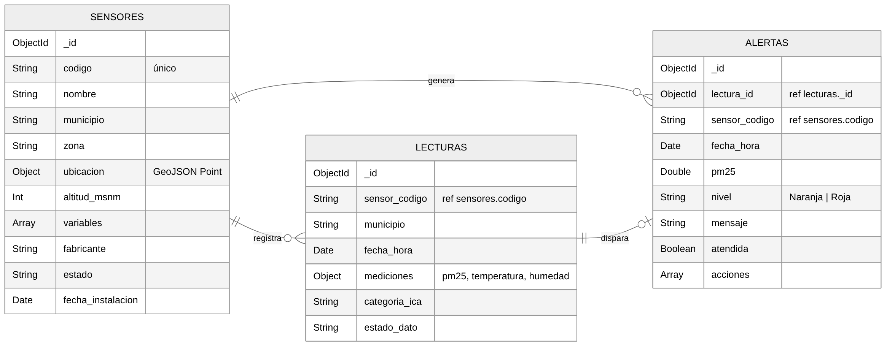

# Tarea 4 – Almacenamiento y Consultas de Datos en Big Data (MongoDB)

**Universidad Nacional Abierta y a Distancia – UNAD**
Curso: Big Data (202016911) · Grupo: 202016911_27
Estudiante: Jesus Antonio Acevedo Montoya
Tutor: Javier Antonio Ballesteros Ricaurte

## Caso de uso

**Monitoreo de la calidad del aire en el Valle de Aburrá.** Una red de estaciones (sensores) ubicadas en los 10 municipios del área metropolitana registra cada hora material particulado PM2.5, temperatura y humedad. Cuando el PM2.5 supera 37 µg/m³ se genera una alerta.

MongoDB es apropiado porque:

- Las lecturas llegan en gran volumen y con estructura flexible (cada sensor puede medir variables distintas).
- Los documentos guardan subdocumentos (`mediciones`, `ubicacion`) y arreglos (`variables`, `acciones`) sin necesidad de tablas adicionales.
- Permite consultas geoespaciales (GeoJSON + índice `2dsphere`) y agregaciones para estadísticas.
- Escala horizontalmente (sharding) cuando la red crece.

Este caso continúa el trabajo de la Tarea 3 (procesamiento con Spark y Kafka de datos de sensores ambientales).

## Diseño de la base de datos

Base de datos: `calidad_aire_aburra`

```
sensores (1) ──< lecturas (N)
    │                │
    └──────< alertas >┘   (cada alerta referencia su sensor y su lectura)
```

### Colección `sensores` (10 documentos)

| Campo | Tipo | Descripción |
|---|---|---|
| `_id` | ObjectId | Identificador generado por MongoDB |
| `codigo` | String (único) | Código de la estación, p. ej. `SEN-002` |
| `nombre` | String | Nombre de la estación |
| `municipio` | String | Municipio del Valle de Aburrá |
| `zona` | String | Urbana, Suburbana o Rural |
| `ubicacion` | Subdocumento GeoJSON | `{ type: "Point", coordinates: [lon, lat] }` |
| `altitud_msnm` | Int | Altitud en metros sobre el nivel del mar |
| `variables` | Array<String> | Variables que mide el sensor |
| `fabricante` | String | Marca del equipo |
| `estado` | String | activo / mantenimiento |
| `fecha_instalacion` | Date | Fecha de instalación |

### Colección `lecturas` (150 documentos)

| Campo | Tipo | Descripción |
|---|---|---|
| `_id` | ObjectId | Identificador |
| `sensor_codigo` | String | Referencia a `sensores.codigo` |
| `municipio` | String | Copia del municipio (desnormalizado para filtrar rápido) |
| `fecha_hora` | Date | Fecha y hora de la medición (UTC) |
| `mediciones` | Subdocumento | `{ pm25, temperatura, humedad }` |
| `categoria_ica` | String | Buena, Aceptable, Dañina para grupos sensibles, Dañina para la salud |
| `estado_dato` | String | valido / sospechoso |

### Colección `alertas` (55 documentos)

| Campo | Tipo | Descripción |
|---|---|---|
| `_id` | ObjectId | Identificador |
| `lectura_id` | ObjectId | Referencia a `lecturas._id` |
| `sensor_codigo` | String | Referencia a `sensores.codigo` |
| `fecha_hora` | Date | Momento de la lectura crítica |
| `pm25` | Double | Valor que disparó la alerta |
| `nivel` | String | Naranja (37–55 µg/m³) o Roja (> 55 µg/m³) |
| `mensaje` | String | Texto descriptivo |
| `atendida` | Boolean | Si la alerta ya fue gestionada |
| `acciones` | Array<Subdocumento> | Historial de acciones tomadas |

**Total: 215 documentos** de prueba (generados con semilla fija, así que siempre son los mismos).



## Scripts

| Script | Contenido |
|---|---|
| `scripts/01_crear_bd_e_insertar.js` | Crea la base de datos, las colecciones, los índices e inserta los 215 documentos |
| `scripts/02_consultas_crud.js` | Inserción (`insertOne`, `insertMany`), selección (`find`, `findOne`), actualización (`updateOne`, `updateMany`, `$set`, `$push`, `$inc`) y eliminación (`deleteOne`, `deleteMany`) |
| `scripts/03_filtros_operadores_join.js` | Operadores de comparación, lógicos, de conjuntos, `$regex`, arreglos, `$exists`, geoespacial (`$near`) y joins con `$lookup` |
| `scripts/04_agregaciones.js` | Contar, sumar, promediar, máximos/mínimos, agrupación por hora, `$bucket` y `$facet` |

## Cómo ejecutarlo

Requisitos: MongoDB 6.0 o superior (probado para 8.0) y `mongosh`. En la VM (Ubuntu 26.04) se ejecuta con Docker:

```bash
git clone https://github.com/JesusAMPY/UNAD_BigData_Tarea4_Jesus_Acevedo.git
sudo docker run -d --name mongodb -p 27017:27017 -v ~/UNAD_BigData_Tarea4_Jesus_Acevedo:/tarea4 mongo:8.0

sudo docker exec mongodb mongosh --quiet /tarea4/scripts/01_crear_bd_e_insertar.js
sudo docker exec mongodb mongosh --quiet /tarea4/scripts/02_consultas_crud.js
sudo docker exec mongodb mongosh --quiet /tarea4/scripts/03_filtros_operadores_join.js
sudo docker exec mongodb mongosh --quiet /tarea4/scripts/04_agregaciones.js
```

Con MongoDB instalado localmente basta con `mongosh --quiet scripts/01_crear_bd_e_insertar.js` (y así con los demás).

Los scripts se ejecutan en ese orden. El script 01 borra y vuelve a crear la base de datos, así que se puede volver a empezar desde cero cuando se quiera.

La guía de instalación de MongoDB en Ubuntu está en [docs/instalacion_mongodb_ubuntu.md](docs/instalacion_mongodb_ubuntu.md).
